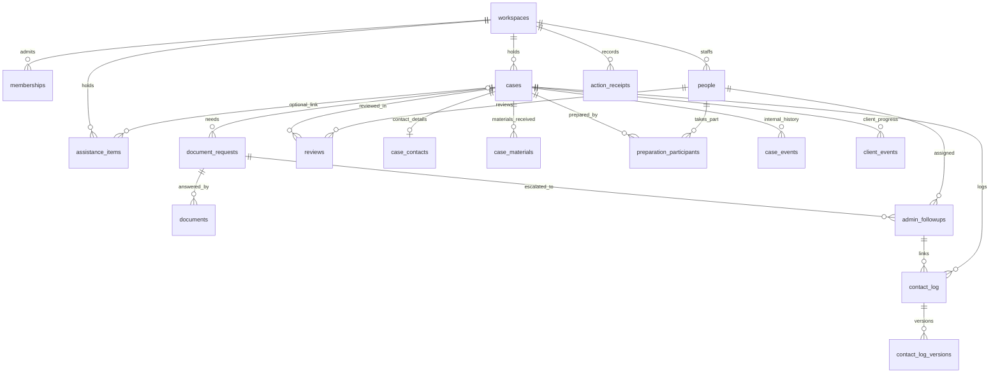
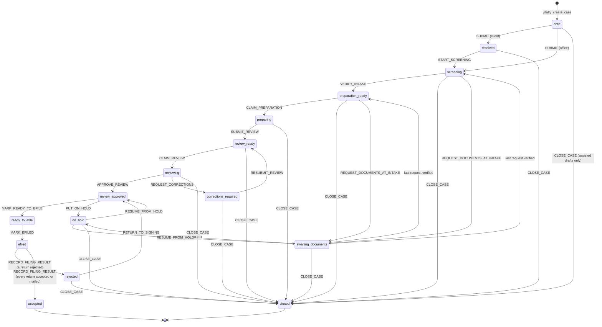

# Database

PostgreSQL on Supabase is ViTally's back end. It holds the data, decides who can read which rows,
and runs every workflow change inside one function call. This page is the reference for all of
it. Run everything described here against the local stack from [`docs/setup.md`](../setup.md).

## Contents

- [Migrations](#migrations)
- [Schema](#schema)
- [Who can see what](#who-can-see-what)
- [The action API](#the-action-api)
- [The case state machine](#the-case-state-machine)
- [Action catalogue](#action-catalogue)
- [The contact log](#the-contact-log)
- [Check order and error codes](#check-order-and-error-codes)
- [Concurrency and idempotency](#concurrency-and-idempotency)
- [Realtime](#realtime)
- [Sample cases, reset and checkpoints (demo only)](#sample-cases-reset-and-checkpoints-demo-only)
- [Changing the database](#changing-the-database)
- [Recipes](#recipes)
- [Testing](#testing)

## Migrations

The schema is thirty-two plain SQL files in [`supabase/migrations/`](../../supabase/migrations/), applied
in order by [`tools/admin/migrate.mjs`](../../tools/admin/migrate.mjs).

| File | Adds |
| --- | --- |
| `001_identity_and_cases.sql` | Workspaces, memberships, people, cases, action receipts; `vitally_create_case`; the workspace initializer; base RLS |
| `002_workflow_schema.sql` | Document requests, documents, admin follow-ups, contact attempts, internal and client history, participation, assistance items; their RLS |
| `003_action_core.sql` | `vitally_apply_action` and its shared checks; intake actions and the preparation claim |
| `004_documents_followup.sql` | Document request/response/verification; admin follow-up escalation, contact, resolution |
| `005_assistance_closure.sql` | Assistance items' own entry point; reminders; case closure |
| `006_review.sql` | The `reviews` table and every review action; the final version of the dispatcher |
| `007_realtime_publication.sql` | The twelve tables published to Realtime, INSERT and UPDATE only |
| `008_case_timestamps.sql` | `cases.created_at` and `cases.updated_at`; the final `commit_action` |
| `009_fixtures_and_realtime.sql` | Six sample cases, presenter reset, checkpoints (demo only) |
| `010_client_numbers.sql` | `workspaces.current_season`; `cases.season` and `client_number` (one per submitted case in each workspace and season), assigned by a trigger on submit |
| `011_intake_v2.sql` | The version-2 intake, schema only: `workspaces.default_intake_version` and `cases.intake_version`; the private `intake_fields` catalogue table and its loader; value, visibility and missing-field checks; `case_contacts`; version-2 SAVE_ANSWERS and SUBMIT |
| `012_intake_catalogue_<hash8>.sql` | Generated by `npm run build:intake`: the first load of the version-2 catalogue into `intake_fields` |
| `013_contact_materials.sql` | `case_materials`; the UPDATE_CONTACT and RECORD_MATERIALS actions |
| `014_intake_catalogue_<hash8>.sql` | Generated in part 4b: reloads the same catalogue rows as 012. It exists because part 4b renamed three step titles, and the hash covers the whole catalogue (see below) |
| `015_intake_loader.sql` | The loader for the redesigned catalogue: the hidden `id` field type (`hh.member_id`); the private `intake_substeps` table, one row per sub-step in order; household members refused without a well-formed, unique `member_id` |
| `016_intake_catalogue_<hash8>.sql` | Generated: the redesigned catalogue (steps 0–9 with sub-steps), loaded through 015 |
| `017_documents_and_visits.sql` | `cases.intake_visited`; `case_document_cards`; `document_card_rules()`; the SET_DOCUMENT_CARD and SET_DOCUMENT_GROUP actions; SAVE_ANSWERS takes an optional `visited` list |
| `018_document_card_authority.sql` | Card authority: SET_DOCUMENT_CARD and SET_DOCUMENT_GROUP for staff who work on the case (`works_on_case`: office staff on any case, a volunteer as its preparer or reviewer), no longer a capability |
| `019_fixtures_v2.sql` | Samples follow the workspace's version: version-2 samples (answers, a `case_contacts` row, a household member with a fixed `member_id`) in a version-2 workspace; a checkpoint reload clears the sample's materials and card marks |
| `020_intake_v2_default.sql` | The switch-over: version 2 is the default intake version (column default and every workspace). Redefines no function, so it gives the same result before or after 021 and 022. Existing cases kept their version until 023 |
| `021_review_approved_message.sql` | The review-approved history line says signing and filing come next; `act_approve_review` (006) and `fixture_history` (009) copied with only that sentence changed |
| `022_intake_catalogue_<hash8>.sql` | Generated: the wording review's catalogue text (upload tips that list several documents say "them") |
| `023_remove_intake_v1.sql` | Version 2 is the only intake version. The rule as two pure predicates (`version_one_blocks`, `version_one_disposable`) and a count (`version_one_blockers`); a guard that refuses while a version-1 case exists that is neither a sample nor in a test workspace; the cleanup of the rest (children cascade, `fixture_generation` moves); every workspace set to 2; the functions below redefined without their version-1 paths; `intake_answer_keys` and `fixture_answers` dropped; both version `CHECK`s narrowed to 2 |
| `024_intake_catalogue_59560589.sql` | Generated: the household middle name (`hh.middle_name`), and `gcf_tp_signature`/`gcf_sp_signature` required to submit when shown |
| `025_intake_catalogue_194034c5.sql` | Generated by `npm run build:intake`: not-married wording for Q5.2, Q9.1a, Q12.4, the nine income/expense/event leads and section 6's intro; the senior leads say 您爱人 (text only); for an unmarried client, Q5.3–Q5.9 ask directly and every "who" question offers Yes/No |
| `026_intake_catalogue_2239685d.sql` | Generated by `npm run build:intake`: Q0.5 `language_also` (the client's other service languages, multi-select, optional) and Q0.6 `language_also_other` (its "Please specify", shown if Q0.5 includes Other) |
| `027_intake_show_if_any_and_year_range.sql` | Hand-written: `intake_holds` reads the show-if conditions `gte`, `lte` (a whole number at least or at most `value`) and `any` (one of its AND groups holds); the loader checks them through the new `intake_show_if_ok`; `check_intake_value` applies a year's `min_value`/`max_value` |
| `028_intake_catalogue_40593b97.sql` | Generated by `npm run build:intake`: the spouse questions follow rule `spouse_on_return` (married, or widowed with the death from 2023 to 2025) or rule `joint_possible` (married, or a 2025 death); `spouse_death_year` is 1900–2025 |
| `029_intake_catalogue_9ee07ca8.sql` | Generated by `npm run build:intake`: Sections 15 and 16, the Form 14446 consent at 0.4 and the signatures at 1.5 |
| `030_fixture_answers_14446.sql` | Hand-written: the sample cases' Form 14446 answers |
| `031_contact_log.sql` | Hand-written: the contact log (`contact_log`, `contact_log_versions`), its two functions `vitally_log_contact` and `vitally_edit_contact`, the one-time move of the old call attempts, `RECORD_CONTACT` refusing new requests, and the fixture change |
| `032_screening_and_efiling_stages.sql` | Hand-written: the `screening`, `ready_to_efile` and `efiled` stages, `START_SCREENING`, `MARK_READY_TO_EFILE` and `MARK_EFILED`, `VERIFY_INTAKE` from `screening`, an office submit landing in `screening`, and `CLOSE_CASE` from `screening` |
| `033_review_questionnaires.sql` | Hand-written: `preparer_questionnaires` and `reviewer_questionnaires` (staff-only), `admin_followups.purpose` and a nullable `request_id`, `cases.signing_plan` and `signing_appointment_at`; `SUBMIT_REVIEW`, `RESUBMIT_REVIEW` and `APPROVE_REVIEW` take a questionnaire; an approval settles the contact step and, when the reviewer did not go over the return, opens a `go_over_return` task for the office; `MARK_READY_TO_EFILE` waits for an open go-over task; the sample cases seed questionnaires |
| `034_screening_checks.sql` | Hand-written: `VERIFY_INTAKE` records the real screening checks, `phone`, `documents` and `in_scope`, plus `identity` only when the case's `service` answer is `online` (a replayed old four-key payload is refused); the client's history line is "PCDC finished screening your application. A volunteer will start preparing your return next."; `check_payload`, `act_verify_intake` and `fixture_history` replaced, and the sample cases record the new checks |
| `035_post_efiling_stages.sql` | Hand-written: the `rejected` and `accepted` stages; `cases.federal_method`, `state_method`, `federal_result` and `state_result`; the staff-only `filing_attempts`, `filing_returns` and append-only `filing_notes`; `MARK_EFILED` records each return's method; `RECORD_FILING_RESULT` and `RETURN_TO_SIGNING`; `CLOSE_CASE` from `rejected`; the `rejected` and `accepted` sample cases |
| `036_hold_and_closing.sql` | Hand-written: the `awaiting_documents` and `on_hold` stages; `cases.documents_origin`, `hold_origin` and `closing_reason`; `REQUEST_DOCUMENTS_AT_INTAKE`, `PUT_ON_HOLD`, `RESUME_FROM_HOLD` and the client's `WITHDRAW`; `CLOSE_CASE` takes one of six reasons and an optional note, and is also allowed from the two new stages; an admin may record and verify documents there; the `withdrawal_notice` follow-up purpose; the `on_hold` and `withdrawn` sample cases |

**Catalogue changes ship as a new `NNN_intake_catalogue_*.sql` written by `npm run build:intake`;
never edit an applied one.** The build writes a file only when the hash differs from the newest
catalogue migration's. The hash covers the catalogue and `LOADER_VERSION` in
[`tools/build-intake-catalogue.mjs`](../../tools/build-intake-catalogue.mjs).

- **Bump `LOADER_VERSION`** when 011's `load_intake_catalogue` or the `intake_fields` columns
  change. The bump changes the hash, so the next `npm run build:intake` writes a new catalogue
  migration that reloads the unchanged catalogue through the new loader.
- **Any catalogue change needs a new migration, even one the database doesn't store.** Step
  titles and wording aren't in `intake_fields`, but the hash covers the whole catalogue, and the
  newest catalogue migration must carry the current hash (`tests/intake-build.test.mjs`). That is
  why 014 reloads the same rows as 012.
- **One catalogue migration per branch, and it should be the newest migration on it.** Only
  migrations on `main` are immutable. If the catalogue changes again on a branch, or after
  rebasing onto `main`, delete the branch's catalogue migration and run `npm run build:intake`;
  never stack a second one on the same branch. The build numbers the file one past the highest
  migration present, so on a branch that already has a later migration it writes the next number
  after that one: rename it back to the deleted file's number. The file's text doesn't contain
  its number.
- **Re-applying a changed migration on a local test stack** (only one of your branch's own
  migrations, written to be safe to apply again) means forgetting it **and every later migration
  that replaces the same functions**, then running `npm run db:migrate:test`. For example, while
  011–013 were still on their branch, forgetting `011_intake_v2.sql` alone would have re-run 011's
  `check_payload` over 013's newer one, so UPDATE_CONTACT and RECORD_MATERIALS would have failed
  validation; the three had to be forgotten together:

  ```sh
  docker ps --format '{{.Names}}' | grep supabase_db_vitally-task2   # the db container
  docker exec <db container> psql -U postgres -c \
    "delete from vitally_private.schema_migrations where name in ('<your migration>.sql','<each later one that replaces its functions>.sql')"
  npm run db:migrate:test
  ```

  Only migrations not yet on `main` may be changed; never 001–014.

Later migrations replace earlier functions with `create or replace`. When you need the current
version of a function, use the **last** file that defines it:

| Function | Current definition |
| --- | --- |
| `public.vitally_apply_action`, `vitally_private.check_operation_authority` | `036_hold_and_closing.sql` |
| `vitally_private.check_payload`, `check_authority`, `receive_document`, `act_verify_document` | `036_hold_and_closing.sql` |
| `vitally_private.act_verify_intake` | `034_screening_checks.sql` |
| `vitally_private.act_submit_review`, `act_resubmit_review`, `act_approve_review`, `act_mark_ready_to_efile`, `act_resolve_followup` | `033_review_questionnaires.sql` |
| `vitally_private.check_related`, `act_save_answers` | `023_remove_intake_v1.sql` |
| `vitally_private.put_intake_field`, `load_intake_catalogue`, `check_intake_value` | `015_intake_loader.sql` |
| `vitally_private.commit_action` | `008_case_timestamps.sql` |
| `vitally_private.initialize_workspace` | `001_identity_and_cases.sql` |
| `public.vitally_create_case` (answers must be `{}`), `vitally_private.cases_intake_version_insert` | `023_remove_intake_v1.sql` |
| `vitally_private.act_update_contact` | `023_remove_intake_v1.sql` |
| `vitally_private.act_submit`, `act_start_screening` | `032_screening_and_efiling_stages.sql` |
| `vitally_private.act_close_case` | `036_hold_and_closing.sql` |
| `vitally_private.act_request_documents_at_intake`, `act_put_on_hold`, `act_resume_from_hold`, `act_withdraw` | `036_hold_and_closing.sql` |
| `vitally_private.act_mark_efiled`, `act_record_filing_result`, `act_return_to_signing` | `035_post_efiling_stages.sql` |
| `vitally_private.version_one_blocks`, `version_one_disposable`, `version_one_blockers` | `023_remove_intake_v1.sql` |
| `vitally_private.load_intake_catalogue`, `check_intake_value`, `intake_holds`, `intake_missing` | `011_intake_v2.sql` |
| `vitally_private.works_on_case` | `013_contact_materials.sql` |
| `vitally_private.fixture_answers_v2` | `036_hold_and_closing.sql` |
| `vitally_private.fixture_contact_v2` | `019_fixtures_v2.sql` |
| `vitally_private.apply_fixture_scenario`, `fixture_history`, `fixture_keys` | `036_hold_and_closing.sql` |
| `vitally_private.seed_fixtures` | `023_remove_intake_v1.sql` |
| `public.vitally_assistance_action` | `005_assistance_closure.sql` |

To list every function with its file and line:

```sh
grep -n -E "^create (or replace )?function" supabase/migrations/*.sql
```

## Schema

Two schemas:

- **`public`**: the application tables and the seven browser-callable functions.
- **`vitally_private`**: helper functions, the migration ledger, and tables browsers must never
  reach. Every function here is `SECURITY DEFINER` with `search_path=''`, and `EXECUTE` is revoked
  from every role, including `service_role`.

Every application row carries `workspace_id`, and foreign keys are **composite**
(`(workspace_id, id)`), so a row can never point at a record in another workspace.



### Tables

| Table | Purpose | Notable columns and rules |
| --- | --- | --- |
| `workspaces` | One site's data set | `default_followup_person_id` (who gets escalations), `fixture_generation` (moves on every sample reset), `current_season` (010), `default_intake_version` (011; new cases take it; default 2 since 020, and only 2 since 023) |
| `memberships` | Account access to a workspace | `access` is `applicant` or `presenter`; `active`; **one active membership per account** (unique index) |
| `people` | Staff members | `person_key` (`alex`, `morgan`, `sam`), `name`, `capabilities` from `prepare`, `review`, `admin`, `followup`, `receive_documents`, `assist` |
| `cases` | One client application | `reference` (`VT-XXXX-XXXX`, unique), `origin` (`client`, `assisted`, `fixture`), `owner_user_id` (the client account; null for assisted and unbound sample cases), `answers` (JSON object: the catalogue ids with structured values: strings, arrays, household member objects; never the contact fields), `stage`, `revision`, `preparation_version`, `intake_verified`, `preparer_id`, `reviewer_id`, `last_reminded_*`, `created_at`, `updated_at`, `season` and `client_number` (010; assigned on submit, never changed), `intake_version` (011; copied from the workspace on insert, never changed; only 2 since 023), `intake_visited` (017; the sub-steps the client has opened, a union of what each save sends), `signing_plan` and `signing_appointment_at` (033; the only part of a questionnaire a client reads: how and when to sign Form 8879), `federal_method` and `state_method` (035; `efile` or `paper`; both null or one of three combinations: efile/efile, efile/paper, paper/paper), `federal_result` and `state_result` (035; `accepted` or `rejected` for an e-filed return, `mailed` for a paper one; null until its method is set and answered). A client reads these four columns and nothing else about a filing, `documents_origin` and `hold_origin` (036; the stage a documents request came from and the case returns to, `screening` or `preparation_ready`, and where a hold came from, `awaiting_documents` or `review_approved`; both null otherwise, and both cleared when the case returns), `closing_reason` (036; one of `out_of_scope`, `no_need_to_file`, `duplicate`, `dismissed`, `withdrawn`, `other`; null for a case closed before 036 and for any open case. A client reads the reason's key and never a note) |
| `action_receipts` | One row per accepted or in-flight action | Unique `(workspace_id, actor_user_id, action_id)`; `request_digest` (SHA-256 of the envelope); `receipt` (the stored result). No foreign key to the target, so receipts outlive deleted cases |
| `preparation_participants` | Who ever prepared a case | Primary key `(case_id, person_id)`. Written on a preparation claim and never removed. Blocks self-review |
| `document_requests` | A preparer asking for a document | `status`: `open` → `awaiting_verification` → `verified`, or `cancelled` on closure |
| `documents` | A received document (metadata only) | `source` is `client` (no person) or `staff_recorded` (a person); `filename` only, **no file storage** |
| `admin_followups` | An office task to contact a client: about a document request, or (033) to go over the return with the client | `purpose` (`request_documents`, `go_over_return` or (036) `withdrawal_notice`, the contact log's keys; a `withdrawal_notice` has no request, and tells the office to stop the preparer's or reviewer's work); `request_id` is set for `request_documents` and null for the other two; `status`: `open`, `resolved`, `cancelled`; at most one open task per request; resolution outcome `reached` or `no_further_contact` |
| `contact_attempts` | Old call attempts on a follow-up | Empty since 031 moved its rows into `contact_log`; kept until a later cleanup. Nothing reads or writes it |
| `contact_log` | The current version of each logged contact | One row per entry on any case: `direction`, `contacted_at` (an instant), `with_whom` (+ `other_name`), `method`, `purpose`, `outcome`, `note`, `followup_id` (null unless logged from a task), `logged_by_*`, `logged_at`, its own `revision`, `edited_at`. The outcome must fit the method. Staff-only; written only by the two contact functions; published to Realtime |
| `contact_log_versions` | Every version of every entry | Primary key `(contact_id, version)`; version 1 is written with the entry, each edit appends the next. Never updated or deleted by a function, so history cannot be rewritten. Staff-only; published to Realtime |
| `reviews` | One review attempt of one preparation version | `status`: `active`, `corrections_requested`, `approved`, `superseded`; one active per case; `findings`, `resolution`, `client_contact_*` |
| `case_events` | Internal audit history, staff-only | `action`, `actor_user_id`, `actor_person_id`, `detail` (JSON), `created_at`. One row per accepted action |
| `client_events` | Plain-language progress a client may read | `action`, `message`. Written only when an action has something to tell the client |
| `case_contacts` | Contact details of a version-2 case | One row per case: client phone and second phone, `best_contact_time`, `best_contact_note`. Client-visible on own cases; written by SAVE_ANSWERS and UPDATE_CONTACT; published to Realtime |
| `case_materials` | Materials the site has received | Primary key `(case_id, item)`; `item` from the eleven-item checklist; `recorded_by_person_id`. Staff-only; written only by RECORD_MATERIALS; published to Realtime |
| `filing_attempts` | One row per filing of a case (035) | Unique `(case_id, attempt)`; `filed_at`, `filed_by`. Staff-only (013's presenter-only select); written only by MARK_EFILED; not in the Realtime publication, so a `cases` update triggers the staff reload |
| `filing_returns` | The federal and the state return of one attempt (035) | Unique `(case_id, attempt, return_kind)`; `method`, `result`, `answered_on` (the acknowledgment or mailing date), `reject_code` (1–40 characters), `recorded_by`. Staff-only; written by MARK_EFILED and RECORD_FILING_RESULT; not in the publication. A reject code never reaches a client |
| `filing_notes` | What the office fixed after a rejection (035) | `case_id`, `attempt`, `note` (1–1000), `recorded_by`, `recorded_at`. Staff-only, **append-only**: a `before update or delete` trigger refuses any change, the service role included. Two exceptions: a note goes with its whole case (a sample reset, or a case or workspace delete), and a sample's checkpoint reload clears the notes of that one sample case. Written by RECORD_FILING_RESULT's `fixNote`; not in the publication |
| `case_document_cards` | The state of a version-2 case's document cards | Primary key `(case_id, slot_id)`; `status` is `later`, `none`, or null for "Not done"; `group_override` is null or `needed` (staff moved a Maybe card up). One row per card someone has marked; written only by SET_DOCUMENT_CARD and SET_DOCUMENT_GROUP; never deleted. **No person column**: the client reads these rows and Realtime sends them whole; who changed a card is in `case_events`. Published to Realtime (insert and update) |
| `vitally_private.intake_fields` | The version-2 question catalogue | Private; one row per question and per household sub-field (`hh.dob`), with type, options, required flag and show-if rule. Loaded (replaced whole) by each catalogue migration through `load_intake_catalogue`; read by the server-side answer checks. It holds no wording |
| `vitally_private.intake_substeps` | The version-2 sub-steps, in order | Private; one row per catalogue sub-step (id, step, position), loaded with the catalogue through 015's `load_intake_catalogue`; read by SAVE_ANSWERS' `visited` check |
| `assistance_items` | Requests for help with forms, beside the tax workflow | Own `revision`; `status`: `open` → `assigned` → `resolved`; optional `case_id`; `language`, `contact_preference` |
| `vitally_private.schema_migrations` | Migration ledger | `name`, `digest` (SHA-256 of the file) |
| `vitally_private.fixture_client_bindings` | Which client account owns which sample case | Demo only |
| `vitally_private.test_workspaces` | Workspaces created by test runs | Test only |

Every text column has a length check, and every status column has an allowed-values check. To see
all of them, open `psql` inside the local stack's database container (no password or URL needed)
and describe a table:

```sh
docker exec -it supabase_db_<your-instance-id> psql -U postgres
```

```text
postgres=# \d+ public.cases
postgres=# \df vitally_private.*
postgres=# select tablename, policyname, qual from pg_policies where schemaname = 'public';
```

## Who can see what

Row-level security is enabled on every `public` table. Browsers have `SELECT` only; there is no
`INSERT`, `UPDATE` or `DELETE` grant for `anon` or `authenticated` on any table, and `anon` has no
grants at all.

| Table | Applicant (client) | Presenter (staff) |
| --- | --- | --- |
| `cases` | Own cases | All cases except client drafts not yet submitted |
| `document_requests`, `documents`, `client_events`, `case_contacts`, `case_document_cards` | On own cases | On visible cases (so a client's own draft's cards only after submit) |
| `case_materials` | Nothing | On visible cases |
| `case_events`, `preparation_participants`, `admin_followups`, `contact_log`, `contact_log_versions`, `reviews` | Nothing | On visible cases |
| `contact_attempts` | Nothing | On visible cases (empty) |
| `preparer_questionnaires`, `reviewer_questionnaires` | Nothing | Presenters only, on visible cases |
| `assistance_items` | Nothing | All unlinked items, and items on visible cases |
| `people` | Nothing | Everyone in the workspace |
| `memberships` | Own active membership | Own active membership |
| `workspaces` | Own workspace | Own workspace |
| `action_receipts` | Nothing (no policy, no grant) | Nothing |

The case-visibility rule appears inline in each policy:

```sql
exists (select 1 from memberships m
        where m.workspace_id = <row>.workspace_id
          and m.user_id = (select auth.uid()) and m.active
          and ((m.access = 'applicant' and <case>.owner_user_id = m.user_id)
            or (m.access = 'presenter' and (<case>.origin <> 'client' or <case>.stage <> 'draft'))))
```

It is repeated rather than put in a helper function because a helper would need `EXECUTE` granted
to browsers. A database test checks that all copies agree. If you change the rule, change every
policy and `vitally_private.lock_case` (which applies the same rule to writes) in one migration.

## The action API

Browsers can call exactly seven functions. Each runs as its owner (`SECURITY DEFINER`), checks the
caller itself, and returns a JSON receipt.

| Function | Purpose | Returns |
| --- | --- | --- |
| `vitally_create_case(p_action_id uuid, p_mode text, p_person_id uuid, p_answers jsonb)` | New draft. `p_mode` is `client` (an applicant, no person) or `assisted` (a presenter acting as an `admin` person, for a walk-in client) | `{actionId, caseId, reference, revision}` |
| `vitally_apply_action(p_action_id uuid, p_case_id uuid, p_expected_revision bigint, p_person_id uuid, p_type text, p_payload jsonb)` | Every case workflow action (the types in `CASE_ACTIONS`, [`src/contracts.mjs`](../../src/contracts.mjs)) | `{actionId, caseId, reference, revision}` |
| `vitally_assistance_action(p_action_id uuid, p_item_id uuid, p_expected_revision bigint, p_person_id uuid, p_type text, p_note text)` | `CLAIM` or `RESOLVE` an assistance item | `{actionId, itemId, revision}` |
| `vitally_log_contact(p_action_id uuid, p_case_id uuid, p_person_id uuid, p_followup_id uuid, p_entry jsonb)` | Log a contact on a case, optionally linked to an open follow-up task | `{actionId, contactId, caseId, revision}` |
| `vitally_edit_contact(p_action_id uuid, p_contact_id uuid, p_expected_revision bigint, p_person_id uuid, p_entry jsonb)` | Edit a logged contact; appends a version | `{actionId, contactId, caseId, revision}` |
| `vitally_reset_fixtures(p_action_id uuid)` | Demo only: rebuild the ten sample cases | `{actionId, generation, fixtureCaseIds}` |
| `vitally_load_checkpoint(p_action_id uuid, p_case_id uuid, p_expected_revision bigint, p_checkpoint text)` | Demo only: move one sample case to a story point | `{actionId, caseId, reference, revision}` |

`p_person_id` is the staff person the caller acts as. Applicants must send `null`. Presenters send
the persona they chose.

The exact signatures are pinned by a test ([`tests/support/rpc-signatures.mjs`](../../tests/support/rpc-signatures.mjs)),
so adding an eighth function or changing an argument fails the database suite until the list is
updated.

### Calling it

From the browser (supabase-js):

```js
const { data: receipt, error } = await supabase.rpc("vitally_apply_action", {
  p_action_id: crypto.randomUUID(),   // keep it: a retry must reuse it
  p_case_id: caseId,
  p_expected_revision: currentRevision,
  p_person_id: actingPersonId,        // null for a client
  p_type: "REQUEST_DOCUMENT",
  p_payload: { title: "Mileage record", message: "Please send your 2025 mileage log." },
});
// error.code is "VT001".."VT007", "42501", or absent for a network failure
```

From SQL, impersonate a signed-in user inside a transaction; the functions read `auth.uid()` from
the JWT claims:

```sql
begin;
set local role authenticated;
set local request.jwt.claims = '{"sub": "<auth user id>", "role": "authenticated"}';
select public.vitally_apply_action(gen_random_uuid(), '<case id>', 3, '<person id>', 'CLAIM_PREPARATION', '{}');
rollback;
```

`psql` prints a refusal as `ERROR:  VALIDATION`; run `\set VERBOSITY verbose` first to also see the
`VT00N` code.

## The case state machine



Document requests, admin follow-ups and review contact are **not stages**. They are records beside
the stage that can block a transition: `SUBMIT_REVIEW` and `RESUBMIT_REVIEW` refuse while any
document request is `open` or `awaiting_verification`. An open admin follow-up never blocks
preparation.

`accepted` is the end of the demo's main chain. `efiled` waits for the IRS's and Pennsylvania's
answers, which an admin records by hand (035); `rejected` goes back to signing and is filed again.
Amendments, reassignment, same day and FSA are not built; see the
[roadmap](production-roadmap.md#4-workflow-coverage). Waiting for documents and Hold (036) are:
`REQUEST_DOCUMENTS_AT_INTAKE` (1 to 5 requests, from `screening` or `preparation_ready`) opens
`awaiting_documents` and records `documents_origin`; an admin records and verifies the documents
there and at a documents Hold, and verifying the last request returns the case to its origin
automatically, clearing both origins. `PUT_ON_HOLD` (optional staff note) takes `awaiting_documents`
or `review_approved` to `on_hold` and records `hold_origin`; `RESUME_FROM_HOLD` returns it. The
client's own `WITHDRAW` is allowed from `received` through `reviewing` (including
`awaiting_documents` and `corrections_required`) and on a documents Hold; it closes the case with
reason `withdrawn`, and opens a `withdrawal_notice` follow-up when the client withdraws at
`preparing`, `corrections_required` or `reviewing`. Two moves at the same revision: one wins, the other gets
the revision conflict. The preparer's own document loop during preparation is unchanged. Five
admin-only actions and one submit rule shape the earlier stages:

- A client's `SUBMIT` lands in `received`; an office-entered case's `SUBMIT` (no owner) lands in
  `screening`, because the office has already screened a client it entered itself.
- `START_SCREENING` moves `received` to `screening`. The browser sends it when an admin opens the
  case's page ([Front end](frontend.md#screening-starts-when-an-admin-opens-the-case)).
- `MARK_READY_TO_EFILE` (the client signed Form 8879) and `MARK_EFILED` follow `review_approved`.
  `MARK_READY_TO_EFILE` refuses until the approved review's contact step is `completed`
  (`client_contact_status`), and (033) while the case has an open `go_over_return` follow-up,
  whatever outcome later resolves it.
- `MARK_EFILED` records how each return was filed (`federal` and `state`, each `efile` or `paper`;
  the pair must be one of the three combinations) and opens a filing attempt. After a rejection it
  takes exactly the rejected returns, may change their method, and keeps accepted and mailed ones.
- `RECORD_FILING_RESULT` records the answer for returns still waiting: `accepted` or `rejected`
  for an e-filed return, `mailed` for a paper one, with a date, and a reject code when rejected.
  Any rejected return moves the case to `rejected`; every return accepted or mailed moves it to
  `accepted`; otherwise it stays at `efiled`. At `rejected` it stays offered while a return is
  still waiting. A fix note (`fixNote`) is allowed only when the case is, or becomes, `rejected`.
  A case e-filed before 035 has null methods and is treated as both e-filed.
- `RETURN_TO_SIGNING` moves `rejected` to `review_approved`, and is refused until every return has
  an answer. The methods and results are kept: "returned to signing" is `review_approved` with
  `federal_method` set, so no preparation or review pass repeats and the client signs again.

## Action catalogue

"Presenter + person" means a presenter account acting as a staff person. Capabilities in step 7
are checked after the stage, so a wrong stage is reported before a missing qualification. Two
shorthands in the table:

- **Current preparer** (`require_case_preparer`): the person has `prepare` (else `INELIGIBLE`), is
  the case's `preparer_id`, and is recorded as a participant (else `FORBIDDEN`).
- **Current reviewer** (`require_case_reviewer`): the person never took part in preparing the case
  (else `SELF_REVIEW`), has `review` (else `INELIGIBLE`), and is the case's `reviewer_id` (else
  `FORBIDDEN`).

| Action | Who (step 4) | Allowed when (step 6) | Also requires (step 7) | Effect | Client message |
| --- | --- | --- | --- | --- | --- |
| `SAVE_ANSWERS` | Applicant owner, or presenter + `admin` person on an assisted case | `draft` | Every key and value passes `check_intake_value` against `intake_fields`; one bad value refuses the whole save | Merges answers; the four contact fields go to `case_contacts` instead, and a `null` clears a key | No |
| `SUBMIT` | Same as above | `draft` | No required, visible question missing (`intake_missing`, contact fields read from `case_contacts`); no eligibility screening | → `received` (a client's own case) or `screening` (an office-entered case, no owner); assigns the client number (010) | Yes |
| `START_SCREENING` | Presenter + `admin` person | `received` | | → `screening` | Yes |
| `VERIFY_INTAKE` | Presenter + `admin` person | `screening` | | → `preparation_ready`, `intake_verified` | Yes |
| `CLAIM_PREPARATION` | Presenter + any person | `preparation_ready`, no preparer | `prepare` | → `preparing`; sets preparer; records participation | Yes |
| `REQUEST_DOCUMENT` | Presenter + person | `preparing`, `corrections_required` | Current preparer | New `open` request | Yes (title) |
| `RESPOND_DOCUMENT` | Applicant owner | `preparing`, `corrections_required` | Request is `open` | Client document; request → `awaiting_verification` | Yes |
| `RECORD_DOCUMENT_RESPONSE` | Presenter + `receive_documents` person, case has no owner | `preparing`, `corrections_required` | Request is `open` | Staff-recorded document; request → `awaiting_verification` | Yes |
| `VERIFY_DOCUMENT` | Presenter + person | `preparing`, `corrections_required` | Current preparer; request `awaiting_verification` | Request → `verified` | Yes |
| `ESCALATE_CONTACT` | Presenter + person | `preparing`, `corrections_required` | Current preparer; request `open`; no open task | Follow-up assigned to the workspace's default follow-up person | No |
| `RECORD_CONTACT` | Presenter + `followup` person | (any; task must be open) | Assignee; task `open` | Refused since 031 (`VALIDATION`); contacts are logged with `vitally_log_contact` | No |
| `RESOLVE_FOLLOWUP` | Presenter + `followup` person | (any; task must be open) | Assignee; task `open` | Task → `resolved`; (033) a `go_over_return` task also turns the case's `go_over_first` signing plan into the reviewer's signing method | No |
| `SUBMIT_REVIEW` | Presenter + person | `preparing` | Current preparer; intake verified; no unsettled request | Version + 1; → `review_ready`; active review superseded | Yes |
| `CLAIM_REVIEW` | Presenter + person | `review_ready`, no reviewer | Not a participant (`SELF_REVIEW`); `review` | → `reviewing`; sets reviewer; new `active` review | Yes |
| `REQUEST_CORRECTIONS` | Presenter + person | `reviewing` | Current reviewer; review at current version | Review → `corrections_requested` with findings; → `corrections_required`; reviewer cleared | Yes (no findings) |
| `RESUBMIT_REVIEW` | Presenter + person | `corrections_required` | Current preparer; no unsettled request | Resolution saved; version + 1; → `review_ready` | Yes |
| `APPROVE_REVIEW` | Presenter + person | `reviewing` | Current reviewer; review at current version | Questionnaire saved; review → `approved` with the contact step completed (outcome `reached` when the reviewer went over the return, none when not); signing plan saved; → `review_approved`; a `go_over_return` task for the office when the reviewer did not | Yes |
| `RECORD_REVIEW_CONTACT` | Presenter + person | `review_approved` | Current reviewer; contact `pending` | Outcome saved; `reached` or `no_further_contact` completes it | Only when completed |
| `MARK_READY_TO_EFILE` | Presenter + `admin` person | `review_approved` | The approved review's contact step is `completed`, and no `go_over_return` follow-up is open (else `INVALID_TRANSITION`): it waits for the contact step and for the office's go-over | → `ready_to_efile` | Yes |
| `MARK_EFILED` | Presenter + `admin` person | `ready_to_efile` | Methods form one of the three combinations; a second filing takes exactly the rejected returns | Sets the methods, resets the outstanding results, adds a filing attempt; → `efiled` | Yes |
| `RECORD_FILING_RESULT` | Presenter + `admin` person | `efiled`; `rejected` while a return is waiting | Only waiting returns; result fits the method; date not future and not before the filing; a reject code exactly when rejected | Saves results on `cases` and `filing_returns`, plus a `filing_notes` row for a fix note; → `rejected`, `accepted` or stays | Yes (per return; no code, no note) |
| `RETURN_TO_SIGNING` | Presenter + `admin` person | `rejected` | No return waiting | → `review_approved`; methods and results kept | Yes |
| `REMIND` | Presenter + `admin` person | `preparation_ready` with no preparer, or `review_ready` with no reviewer | | Sets `last_reminded_at` (no message is sent) | No |
| `REQUEST_DOCUMENTS_AT_INTAKE` | Presenter + `admin` person | `screening`, `preparation_ready` | | New `open` requests (1 to 5); → `awaiting_documents`; sets `documents_origin` | Yes (titles) |
| `PUT_ON_HOLD` | Presenter + `admin` person | `awaiting_documents`, `review_approved` | | → `on_hold`; sets `hold_origin`; the note is staff history only | Yes (no note, no phone) |
| `RESUME_FROM_HOLD` | Presenter + `admin` person | `on_hold` | | Back to `hold_origin` | Yes |
| `WITHDRAW` | The client (applicant owner) | `received` through `reviewing` (including `awaiting_documents`, `corrections_required`), and a documents `on_hold` | | → `closed` with reason `withdrawn`; cancels open requests and tasks; a `withdrawal_notice` task at `preparing`, `corrections_required` or `reviewing` | Yes |
| `CLOSE_CASE` | Presenter + `admin` person | `received` through `corrections_required` (`screening` included), `awaiting_documents`, `on_hold` (036), `rejected` (035), or an assisted `draft` | | → `closed` with `closing_reason`; cancels open requests and tasks | Yes (reason only) |
| `UPDATE_CONTACT` | Owner on own draft; `followup` or `admin` person; a preparer or reviewer on their own case | Draft (owner); any (staff) | | Edits best time and note in `case_contacts`; never a phone | No |
| `RECORD_MATERIALS` | Presenter + person (same authority as above); no applicant | Any | | Replaces the set of materials received | No |
| `SET_DOCUMENT_CARD` | Applicant owner, or presenter + a person who works on the case (`works_on_case`, 018; never on a client's unsent draft) | Any but `closed` | | Upserts the card's `status` in `case_document_cards` (`not_done` stores null) | No |
| `SET_DOCUMENT_GROUP` | Presenter + a person who works on the case (`works_on_case`, 018; never on a client's unsent draft) | Any but `closed` | `maybe` only undoes a staff `needed` | Sets or clears the card's `group_override` | No |

Payload shapes are whitelisted exactly in `vitally_private.check_payload`; an extra key is a
`VALIDATION` error, not ignored. The browser builds them in
[`src/case-actions.mjs`](../../src/case-actions.mjs). Summary:

| Action | Payload |
| --- | --- |
| `SAVE_ANSWERS` | `{answers: {<catalogue id>: value \| null}}`, contact fields included; a draft may add `visited: string[]` (sub-step ids, at most 64) |
| `SUBMIT` | `{confirmed: true}` |
| `VERIFY_INTAKE` | `{checks: {phone: true, documents: true, in_scope: true}}`, plus `identity: true` exactly when the case's `answers.service` is `online`; any other set is a `VALIDATION` error (034). The browser builds the set with `screeningCheckKeys(service)` |
| `START_SCREENING`, `CLAIM_PREPARATION`, `CLAIM_REVIEW`, `REMIND` | `{}` |
| `SUBMIT_REVIEW`, `APPROVE_REVIEW` | `{questionnaire}` (the preparer's or the reviewer's, see design D2 and D3) |
| `MARK_READY_TO_EFILE`, `RETURN_TO_SIGNING` | `{confirmed: true}` |
| `MARK_EFILED` | `{confirmed: true, methods: {federal?, state?}}`, each `efile` or `paper` (035) |
| `RECORD_FILING_RESULT` | `{confirmed: true, results: {federal?: {result, date, code?}, state?: {…}}, fixNote? (≤1000)}` (035); `code` ≤40 characters |
| `REQUEST_DOCUMENT` | `{title (≤120), message (≤2000)}` |
| `RESPOND_DOCUMENT`, `RECORD_DOCUMENT_RESPONSE` | `{requestId, filename: "demo-mileage-record-2025.pdf"}` |
| `VERIFY_DOCUMENT` | `{requestId}` |
| `ESCALATE_CONTACT` | `{requestId, reason (≤1000)}` |
| `RESOLVE_FOLLOWUP` | `{followupId, outcome, note (≤1000)}` |
| `RECORD_CONTACT` | Refused since 031 (`VT007`); log contacts with `vitally_log_contact` |
| `UPDATE_CONTACT` | `{bestContactTime?, bestContactNote?}` (null clears) |
| `RECORD_MATERIALS` | `{received: string[]}` |
| `SET_DOCUMENT_CARD` | `{slotId, status: "later" \| "none" \| "not_done"}` |
| `SET_DOCUMENT_GROUP` | `{slotId, group: "needed" \| "maybe"}` |
| `REQUEST_CORRECTIONS` | `{findings (≤2000)}` |
| `RESUBMIT_REVIEW` | `{questionnaire, resolution (≤2000)}` |
| `RECORD_REVIEW_CONTACT` | `{outcome, note (≤1000)}` |
| `CLOSE_CASE` | `{confirmed: true, reason, note? (≤1000)}`; `reason` is one of `out_of_scope`, `no_need_to_file`, `duplicate`, `dismissed`, `withdrawn`, `other`, and `other` needs a note (036) |
| `REQUEST_DOCUMENTS_AT_INTAKE` | `{requests: [{title (≤120), message (≤2000)}]}`, 1 to 5 (036) |
| `PUT_ON_HOLD` | `{confirmed: true, note? (≤1000)}` (036) |
| `RESUME_FROM_HOLD`, `WITHDRAW` | `{confirmed: true}` (036) |

Assistance items have their own two actions through `vitally_assistance_action`: `CLAIM` (item
`open` → `assigned`, needs `assist`, no note) and `RESOLVE` (`assigned` → `resolved`, only the
assignee, note required). They write no case history.

## The contact log

Staff record contacts (calls, texts, emails, visits) in the contact log, on any case, at any
stage. It lives beside the case workflow, not inside it:

- **Its own functions.** `vitally_log_contact` and `vitally_edit_contact` do not go through
  `vitally_apply_action`. The log needs none of the case lifecycle, and leaving the shared action
  helpers alone keeps this change clear of other work that rewrites them. They still follow the
  same pattern: membership, envelope check, receipt, lock, persona checks, write, store the
  receipt. Errors use the same `VT00N` codes. `vitally_edit_contact` locks the entry's case before
  the entry, the same order as every other writer, so two windows cannot deadlock.
- **The case row is untouched.** Neither function changes `cases.revision` or writes
  `case_events` or `client_events`, so logging a contact in one window never turns another
  window's open case form into a conflict. Each entry has its own `revision`, which an edit must
  send as `p_expected_revision`.
- **Who may do what.** Any staff persona may log, unlinked, on a case they can open. Linking to a
  follow-up task (`p_followup_id`) keeps `RECORD_CONTACT`'s old rule: the task is open, the persona
  is its assignee and has `followup`. Only the logger or an `admin` may edit. An applicant is refused.
- **Entries are checked in SQL** (`vitally_private.check_contact_entry`): the outcome must fit the
  method and direction (incoming and in-person contacts are always `reached`), "Other" needs a name,
  and `contactedAt` must carry an offset or `Z` and be no more than five minutes ahead. The browser
  sends an ISO instant.
- **Versions.** Version 1 is written with the entry and each edit appends the next to
  `contact_log_versions`. Nothing is deleted.
- **The old attempts moved once.** In 031, each `contact_attempts` row became a linked log entry
  (outgoing, phone, client, purpose `request_documents`, same time and person):

  | Old outcome | New outcome | Note |
  | --- | --- | --- |
  | `no_answer`, `reached` | the same | the note |
  | `no_further_contact` | `reached` | "Client asked for no further contact. " + the note |
  | `closure_requested` | `reached` | "Client asked to close the case. " + the note |

  A prefixed note is cut to 1000 characters. The old rows were then deleted, and the table was
  taken out of the Realtime publication.
- **`RECORD_CONTACT` refuses.** Its handler `act_record_contact` raises `VT007`, so an old open tab
  cannot write to the retired table. It stays in the action list because removing it would mean
  redefining the shared action code. A replay of an old accepted request still returns its receipt,
  since receipts are checked before the handler. The reviewer's `RECORD_REVIEW_CONTACT` is separate and unchanged.
- **Sample cases.** The `admin_followup` fixture seeds a linked log entry instead of an attempt
  (see [Sample cases](#sample-cases-reset-and-checkpoints-demo-only)).

The screens are described in [Front end: the contact log](frontend.md#the-contact-log).

## Check order and error codes

Every case action runs the same checks in the same order. The order is part of the contract: it
decides which error a caller sees when several things are wrong, and it stops a caller from
learning about records they may not see.

| Step | Check | Error |
| --- | --- | --- |
| 1 | Signed in with an active membership | `VT001` `FORBIDDEN` |
| 2 | Reserve the receipt for this action id; identical replay returns the stored receipt; changed envelope refused | `VT007` `VALIDATION` |
| 3 | Lock the case through the visibility rule; missing, other workspace and another client's case look identical | `VT002` `NOT_FOUND` |
| 4 | Operational authority: applicant vs presenter, the person belongs to this workspace, operational capabilities (`admin`, `followup`, `receive_documents`, `assist`); unknown action type | `VT001` `FORBIDDEN`, `VT007` |
| 5 | Expected revision, then payload shape, then related records belong to this case | `VT003` `CONFLICT`, then `VT007` |
| 6 | Stage window | `VT004` `INVALID_TRANSITION` |
| 7 | Self-review, then `prepare`/`review` qualification, then current assignment, then readiness | `VT005` `SELF_REVIEW`, `VT006` `INELIGIBLE`, `VT001`, `VT004` |
| 8 | Mutate, append `case_events` (and `client_events`), bump revision and `updated_at`, store receipt | |

| SQLSTATE | Domain code | Safe message shown |
| --- | --- | --- |
| `VT001` | `FORBIDDEN` | You do not have access to this step. |
| `VT002` | `NOT_FOUND` | This application is no longer available. |
| `VT003` | `CONFLICT` | Someone else updated this application. Refresh and try again. |
| `VT004` | `INVALID_TRANSITION` | This step is not available right now. |
| `VT005` | `SELF_REVIEW` | A different volunteer has to review this application. |
| `VT006` | `INELIGIBLE` | This volunteer is not qualified for this step. |
| `VT007` | `VALIDATION` | Please check the information and try again. |
| `42501` | `FORBIDDEN` | |
| none (network) | `OFFLINE` | Network error. Please try again later. |
| anything else | `SERVER_ERROR` | Something went wrong. |

Always raise errors as `raise sqlstate 'VT00N' using message='NAME'`. Never raise untyped
exceptions from an application path; the browser would show them as `SERVER_ERROR`.

## Concurrency and idempotency

- **Row lock plus revision.** Step 3 takes `SELECT ... FOR UPDATE` on the case. A second
  simultaneous action waits, then fails step 5 because the revision moved. Exactly one wins.
- **Receipts.** The envelope is digested with SHA-256 (`extensions.digest`). The same action id
  with the same digest returns the stored receipt without re-running anything, even if the case
  was deleted since. The same id with a different digest is `VALIDATION`.
- **Nothing partial.** Any raise rolls back the whole call, including the receipt reservation.
- **Workspace setup and reset** take a transaction-scoped advisory lock per workspace, so two
  presenters resetting at once serialize instead of colliding.

## Realtime

Sixteen tables are published to `supabase_realtime`, INSERT and UPDATE only. `007_realtime_publication.sql`
adds twelve: `cases`, `document_requests`, `documents`, `client_events`, `workspaces`, `people`,
`preparation_participants`, `admin_followups`, `contact_attempts`, `case_events`,
`assistance_items`, `reviews`. `011` adds `case_contacts`, `013` adds `case_materials` and `017` adds `case_document_cards`.
`031` adds `contact_log` and `contact_log_versions` and removes `contact_attempts`.
`action_receipts` is not published. An applicant's window watches seven of them (`CLIENT_TABLES`),
a presenter's all sixteen (`STAFF_TABLES`).

Realtime applies each subscriber's RLS, so the same visibility rules hold for events. Deletes are
not published because a deleted row cannot be authorized. The browser treats events as "something
changed" hints and re-reads. If you add a table the browser should watch, add it to the
publication in a new migration **and** to `SUBSCRIBED_TABLES` in
[`src/supabase-store.mjs`](../../src/supabase-store.mjs); a test asserts the two lists match.

## Sample cases, reset and checkpoints (demo only)

Migration 009 seeds six sample cases, one per story point (`preparation_ready`,
`waiting_documents`, `admin_followup`, `review_ready`, `corrections_required`,
`review_approved`), with fictional answers and history. Migration 035 adds two more, `rejected`
(both returns e-filed, federal accepted, state rejected, with a fictional reject code and fix
note) and `accepted` (both e-filed, both accepted), so a reset seeds eight. Each has its own
filing attempt and return rows. Migration 036 adds `on_hold` (a documents hold with a note) and
`withdrawn` (closed by the client), so a reset now seeds ten.

- **Reset** (`vitally_reset_fixtures`, presenters only) deletes only rows marked `fixture`,
  increments `workspaces.fixture_generation`, and reseeds. Class-created cases, accounts, people
  and receipts are untouched. Reseeded cases get new ids and references.
- **Checkpoint** (`vitally_load_checkpoint`, presenters only) rewrites one sample case's workflow
  records to a named story point: `intake_ready`, `document_requested`, `admin_followup_needed`,
  `ready_for_review`, `corrections_required`. The case keeps its id, reference and owner.
- **Bindings** (`vitally_private.fixture_client_bindings`) let a client account own a sample case
  after every reset. The roster command sets them from `sampleCaseOwners`.
- **The samples are version 2** (019; 023 removed 009's version-1 samples). Each is inserted
  empty (011's insert trigger allows nothing else), then gets its answers from `fixture_answers_v2` and a `case_contacts` row from
  `fixture_contact_v2` (phones `2155550101`–`06`, best time weekday evenings) before its scenario
  is applied. Their household member carries a fixed `member_id`. 023 deleted every version-1
  sample and seeds nothing itself: a workspace has no samples again until the next reset.
- **A checkpoint clears office work on the sample:** its `case_materials` and
  `case_document_cards` rows go with the rest of its workflow records; its `case_contacts` row stays.
- **A reset or checkpoint clears the sample's contact log** with the rest of its work (031 redefines
  `apply_fixture_scenario`, copied whole from 019). The `admin_followup` scenario seeds one linked
  log entry (Sam, outgoing, phone, no answer) where it used to seed a `contact_attempts` row.

None of this belongs in production. See the [roadmap](production-roadmap.md#5-demo-only-parts).

## Changing the database

1. **Never edit a migration that has been applied anywhere.** The migrator stores each file's
   SHA-256 in `vitally_private.schema_migrations` and stops with `MIGRATION_CHANGED` if an applied
   file changes. Add a new numbered file instead: `NNN_short_name.sql`, one past the highest number on `main` and on open branches.
2. **Files are applied once, in name order.** Each run applies every pending file inside one
   transaction and skips files already recorded, so a failure applies nothing. The files are not
   written to be re-run by hand.
3. **To change a function, copy its current definition** (see the table in
   [Migrations](#migrations)) into the new file as `create or replace`, then edit it. Keep the
   `security definer set search_path=''` header.
4. **Re-apply grants in the same file.** End every migration that touches functions with:

   ```sql
   revoke all on all functions in schema vitally_private from public, anon, authenticated, service_role;
   ```

   and, for any `public` function you created or replaced, `revoke all ... from public, anon,
   authenticated; grant execute ... to authenticated;`.
5. **New tables:** composite foreign keys through `workspace_id`, `enable row level security`, one
   `SELECT` policy for `authenticated`, `grant select` only, length and value `CHECK`s, and a
   decision about Realtime.
6. **Apply and test:**

   ```sh
   npm run db:migrate:test
   npm run test:database
   ```

   (with the Node and Docker `PATH` prefix from [`docs/setup.md`](../setup.md#5-tests)).

## Recipes

### Add a workflow action

Example: a reviewer can "release" a review they claimed by mistake.

1. **Vocabulary.** Add `RELEASE_REVIEW` to `CASE_ACTIONS` in [`src/contracts.mjs`](../../src/contracts.mjs).
2. **Migration `NNN_release_review.sql`:**
   - `create or replace vitally_private.check_operation_authority` (current definition: 032) with
     the new type in the right authority group.
   - `create or replace vitally_private.check_payload` (current definition: 034) with the payload
     shape.
   - A new `vitally_private.act_release_review(p_member, p_case, p_person, p_payload)`: stage check
     first (`VT004`), then `require_case_reviewer`, then the change. Return
     `{detail: {...}}` and, if the client should be told, `message`.
   - `create or replace public.vitally_apply_action` (current definition: 032) with one new `when`
     branch.
   - Re-apply grants (see above).
3. **Browser.** A payload builder in [`src/case-actions.mjs`](../../src/case-actions.mjs), an
   eligibility rule in `staffEligibility` ([`src/staff-views.mjs`](../../src/staff-views.mjs)), and
   a button with `data-case-action="RELEASE_REVIEW"`. See
   [Front end: add a button for an action](frontend.md#add-a-button-for-a-new-action).
4. **Tests.** A database test for success, every refusal in check order, and "a rejected action
   commits nothing"; unit tests for the payload builder and eligibility.

### Change the intake questions

Version 2's questions come from one source: the two drafts in
[`docs/intake-questions/`](../intake-questions/). `intake-questions.md` (standard wording) gives
every field's id, type, options, required flag and show-if rule; `intake-questions-senior-v2.md`
gives only the senior wording, and its structure must match the standard one's.

1. **Edit both drafts.** Keep the field ids identical in the two files. A show-if line reads like
   ``**Show if** `marital_status = married` ``; conditions join with ` AND `, and
   `` `<id>` is filled `` tests for any answer.
   `` rule `spouse_on_return` `` or `` rule `joint_possible` `` names one of the builder's spouse rules (`RULES` in `tools/build-intake-catalogue.mjs`), which the builder expands. A rule is an `any` (one of its AND groups holds) of "married" and "widowed, with `spouse_death_year` `gte` the first year and `lte` the tax year". `gte`/`lte` read only a whole number written without a leading zero. The browser (`holds` in `intake-catalogue.mjs`) and the database (`vitally_private.intake_holds`, migration 027) evaluate them the same way. Drafts write only `rule`, never `gte`, `lte` or `any` directly.
2. **Build:** `npm run build:intake`. It rewrites `src/intake-catalogue-data.mjs` and, when the
   catalogue's hash changed, writes the next `NNN_intake_catalogue_<hash8>.sql`, which reloads
   `intake_fields` through `load_intake_catalogue`. Commit both. Follow the
   [catalogue migration rules](#migrations): one per branch, never edit an applied one.
3. **Apply and test:** `npm run db:migrate:test`, then `npm test` and `npm run test:database`.
   `tests/intake-build.test.mjs` fails while the database is behind the committed catalogue, and
   `tests/database-intake.mjs` compares the database's checks (`check_intake_value`,
   `intake_holds`, `intake_missing`) with the browser's (`checkValue`, `isVisible`,
   `missingToSubmit`) over the real catalogue.
4. **A new question type or check** is a change on both sides: `checkValue` in
   [`src/intake-catalogue.mjs`](../../src/intake-catalogue.mjs), its control in
   [`src/intake-form.mjs`](../../src/intake-form.mjs), and `check_intake_value` in a new
   migration. A change to the loader or the `intake_fields` columns also bumps `LOADER_VERSION`.
5. **The fictional filler** (`makeSampleAnswers({ version: 2 })` in
   [`src/sample-data.mjs`](../../src/sample-data.mjs)) must still produce answers that pass every
   check; its unit test says so.

Existing answers are not migrated. A stored answer to a question that no longer exists stays in
`answers`; the browser drops it from its draft and never sends it back. A stored value that no
longer passes a tightened check stays too: the browser withholds it from saves and blocks Submit
until it is changed, while the server's SUBMIT checks only for missing answers. Decide before
removing or tightening a question that open cases already use.

Version 2 is the only intake version since migration 023: both version columns accept only 2,
and a case is created with no answers (`vitally_create_case` refuses any other `p_answers` than
`{}`) and filled through SAVE_ANSWERS.

### Add a staff capability

1. Extend the `people_capabilities_check` constraint in a new migration.
2. Decide whether the check is operational (step 4, `FORBIDDEN`) or a qualification (step 7,
   `INELIGIBLE`), and add it in the matching function.
3. Give it to people through the workspace initializer or a setup script, and mirror it in the
   browser's eligibility helpers.

## Testing

The database suite (`tests/database*.mjs`, 282 tests) runs against the local stack only. Each test
file builds a throwaway workspace with fresh synthetic accounts through
[`tests/support/database-fixture.mjs`](../../tests/support/database-fixture.mjs) and deletes it
afterwards, so tests are independent and leave your rehearsal workspace alone.

What the suite covers, by file:

| File | Covers |
| --- | --- |
| `database.mjs` | Identity, references, ownership, RLS, grants, workspace setup |
| `database-actions.mjs` | The check order, receipts, replay, forged identities, payload whitelists |
| `database-documents.mjs` | Requests, responses, verification, follow-up tasks |
| `database-assistance.mjs` | Assistance items, reminders, closure |
| `database-review.mjs` | Review, corrections, independence, reassignment |
| `database-fixtures.mjs` | Sample seeding, reset, checkpoints |
| `database-client-numbers.mjs` | Client numbers: assignment on submit, seasons, no reuse, the backfill |
| `database-intake.mjs` | Intake versions, the catalogue load, version-2 saves and submits, contact details, materials, and the browser-against-database comparison of every check |
| `database-redesign.mjs` | Visits, `case_document_cards` and the two card actions (017), and who may mark and move cards (018) |
| `database-intake-default.mjs` | The column default, new applications on version 2, version-2 samples, and a checkpoint that clears materials and card marks (019) |
| `database-intake-v1-removed.mjs` | Migration 023: the guard's predicates and count, every workspace on 2, both `CHECK`s refusing 1, an application's fixed version, a create that carries answers refused, the dropped functions, and a reset's eight version-2 samples |
| `database-realtime.mjs` | Realtime privacy between clients and for staff tables |
| `database-store.mjs` | The browser's data adapter against the real database |

Every privileged connection passes the target guard in
[`tools/admin/test-target.mjs`](../../tools/admin/test-target.mjs): loopback addresses only, the
exact container names and ports recorded in `.vitally-targets.json`, and a matching project label.
It is deliberately impossible to point the test suite at a hosted project by accident.

When you add behaviour, test three things: it works; each refusal happens at the right step with
the right code; and a refused call leaves no receipt, event or change behind.
